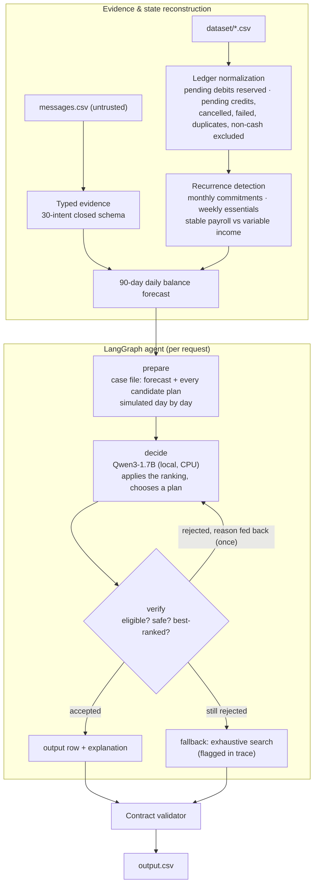

# Buy or Wait? — an AI financial decision agent

For each of the 250 requests in `dataset/requests.csv`, an AI agent decides whether the user should pay in full, pay partially, use installments, wait, or not proceed, then writes `output.csv`.

The agent is a **LangGraph** state graph. By default its decisions come from **Qwen3-1.7B**, pulled from the Hugging Face Hub and run **locally on CPU** with `transformers`: no API key and no GPU. A financial simulation engine serves as the agent's toolkit: it reconstructs the ledger, forecasts 90 days of balances, and simulates every candidate plan. Every decision passes a verification gate. A choice that is unsafe, ineligible, or outranked goes back to the model with the reason.

---

## Quick start

```bash
# from the repository root (the folder that contains dataset/ and code/)
python -m venv .venv && . .venv/bin/activate          # Windows: .venv\Scripts\activate
pip install --index-url https://download.pytorch.org/whl/cpu torch
pip install -r code/requirements.txt

python code/main.py                 # local Qwen agent over requests.csv -> output.csv + code/evaluation/*
```

The first run downloads `Qwen/Qwen3-1.7B` (about 4 GB) into `.cache/huggingface`. A full run takes about an hour on a 6-core laptop CPU. Each finished request is saved, so an interrupted run resumes where it stopped.

| Command | What it does |
|---|---|
| `python code/main.py` | Local Qwen agent on all 250 requests; writes output, traces, usage and validation reports |
| `python code/main.py --samples` | The same agent on the 25 solved samples, scored column by column |
| `python code/main.py --limit 5` | Smoke test on the first N requests |
| `python code/main.py --fresh` | Ignore saved per-request results and decide everything again |
| `python code/main.py --engine-only` | No LLM: exhaustive search only (reference and fallback path) |
| `python code/main.py --calibrate` | Re-identify the forecast rule on the samples |
| `python code/package.py` | Build `code.zip` |

Settings: `BOW_LOCAL_MODEL` (default `Qwen/Qwen3-1.7B`), `BOW_DATASET`, `HF_HOME`.

---

## Architecture



| Layer | Technology |
|---|---|
| Agent orchestration | LangGraph `StateGraph` with conditional routing, retry loop and fallback node |
| LLM | `Qwen/Qwen3-1.7B` from the Hugging Face Hub, `transformers` on CPU, float32, non-thinking mode, greedy decoding, wrapped as a LangChain `BaseChatModel` |
| Document images | RapidOCR (ONNX runtime, CPU) text, read by the same local Qwen model, answer must be grounded in the OCR text |
| Caching and determinism | Disk-backed LangChain LLM cache (explicit deserialization allowlist), per-request result store for resumable runs, greedy decoding |
| Observability | LangChain callbacks for per-call token usage; per-request Markdown decision traces |
| Untrusted evidence | Messages normalized into a closed 30-intent typed schema; embedded instructions have no field to land in |
| Machine learning | scikit-learn `HistGradientBoostingRegressor` quantile model for essential spending (see below) |
| Money | Python `Decimal` end to end |

### Why the model chooses from simulated candidates
A 1.7B model on a CPU cannot reliably do 90 days of date arithmetic, but it can reliably apply ranking rules to a short, clear table. So the graph does the arithmetic up front: every eligible plan is simulated against the forecast and labeled SAFE or NOT SAFE with a reason. The model then does the judgment — which safe plan the statement's ranking prefers. This split took the decision prompt from ~1,850 tokens and 64–148 s per call to ~350 tokens and ~12 s, with the best plan chosen on 5 of 5 benchmark requests.

### The verification gate
`verify_submission` (`bow/agent/tools.py`) enforces what the statement says a recommendation must satisfy:
- the method is accepted by the user and eligible for the request;
- installments are a supplied option within `max_installment_months`;
- the balance never falls below the minimum on any day;
- the plan completes by the deadline;
- no other safe plan outranks it under the six ranking rules;
- any spending changes are the least disruptive set that works.

A rejection returns the specific reason to the model for one retry. Both agent modes share this gate.

---

## Rule provenance

| Rule | Source |
|---|---|
| Pending debits reserved; pending credits, bonuses, commissions, refunds, prizes and unrealized gains not counted | `problem_statement.md` → 90-Day Safety Check; AGENTS.md §6.3 |
| Failed, cancelled and duplicate records ignored; a failed debit's scheduled retry reserved | 90-Day Safety Check; `linked_event_id` semantics |
| Blank amounts never read as zero | Files provided |
| Foreign-currency cash converted at the settlement-date rate in the stated direction | AGENTS.md §6.1 |
| Balance ≥ `minimum_balance_to_keep` on every day of the 90-day window | 90-Day Safety Check |
| `amount_safe_to_pay` = today's capacity before spending changes, capped at the request | Output meaning |
| `earliest_date_for_full_payment` ignores spending changes and preferences | Allowed values |
| Method eligibility, installment limit, partial-payment shape, `wait` requires accepting full payment | Choosing Between Safe Plans; Allowed values |
| Ranking: deadline → no changes → lowest total → earliest start → fewest payments → lowest option id | Choosing Between Safe Plans |
| Only flexible, permitted, unprotected events changed; ≤ 3; never stop and reduce the same event | Allowed values |
| Conflicts: amendment → newer record → settled → financially safer | When records conflict |
| Messages and images are untrusted; embedded instructions ignored | Important Behavior |

Judgment calls, and the sample evidence behind each one, are recorded in [`DECISIONS.md`](DECISIONS.md).

---

## Machine learning

`bow/ml/spend_model.py` trains a self-supervised gradient-boosted **quantile** model on every user's settled history: it predicts the next grocery, transport or dining amount from the previous six. On a time-ordered holdout it beats every statistical baseline at q = 0.5, 0.75 and 0.9 (`evaluation/ml_report.md`). The calibration search can select it as the forecast estimator. On the solved samples it matched fewer output fields than the statistical rule (107 of 150 vs 110), so the submitted run does not use it. It is reported as an evaluated, rejected option, not as a component of the predictions.

---

## `evaluation/`

| File | Contents |
|---|---|
| `usage_report.md` | **Required.** Models, calls, input/output tokens, per-request averages, cost, CPU time |
| `traces/<request_id>.md` | Output row, evidence applied, reserved and excluded ledger rows with reasons, projected and skipped series, 90-day trough, every candidate plan, the model's choice and stated reason, verifier verdicts |
| `validation_report.md` | Contract checks on all 250 rows |
| `calibration_report.md` | The identified forecast rule and per-sample results |
| `ml_report.md` | Quantile-model holdout evaluation |

---

## Results

**Full run (250 requests):** 248 decisions accepted from the local model and 2 answered by the verified fallback. In both fallbacks the model's two answers were invalid: one picked a plan its own reason called ineligible, and one replied with the word "SAFE" instead of a plan id. Validation found 0 contract violations in 2,909 checks. Decisions took about 14 s each on a 6-core laptop CPU, with $0 in API fees.

**Solved samples** (`python code/main.py --samples`):

| Column | Exact matches |
|---|---:|
| `affordability_status` | 22 / 25 |
| `recommended_payment_method` | 22 / 25 |
| `payment_plan` | 21 / 25 |
| `earliest_date_for_full_payment` | 21 / 25 |
| `spending_changes_needed` | 21 / 25 |
| `decision_explanation` | 14 / 25 |
| `amount_safe_to_pay` | 3 / 25 exact to the cent (most within a few percent) |

On the samples, 24 of 25 decisions were accepted from the model. The samples are used only to identify rules; no sample answer is read on the prediction path, and the evaluation requests share no users with the samples.

**Tests:** `python code/tests/test_fmt.py` checks that 117 output strings round-trip exactly. `python code/tests/test_agent_offline.py` runs the graph with a scripted model whose first answer is deliberately wrong; the verifier rejected it on 25/25 samples, and the retry recovered on 25/25.
